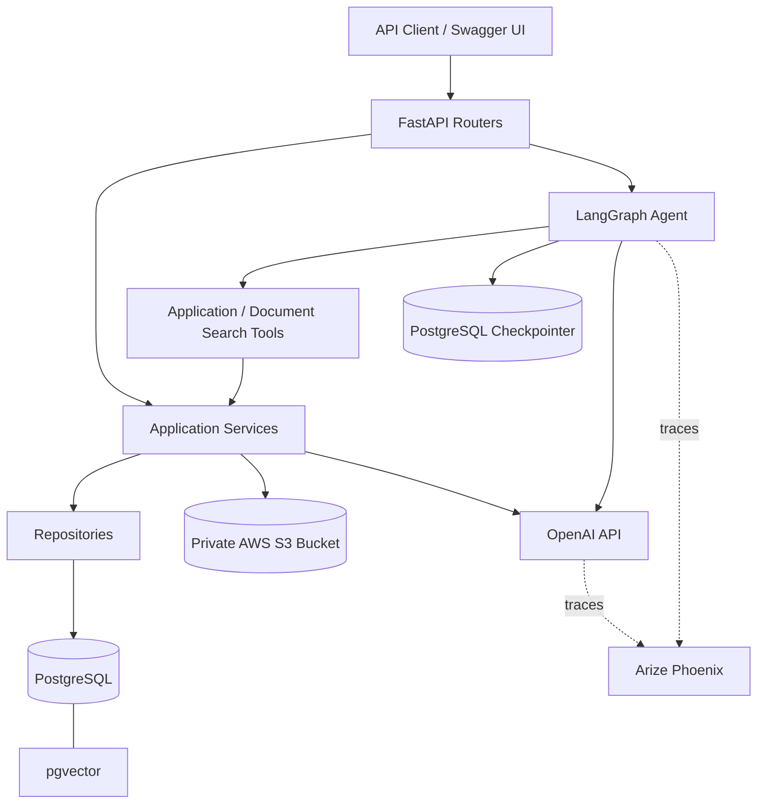
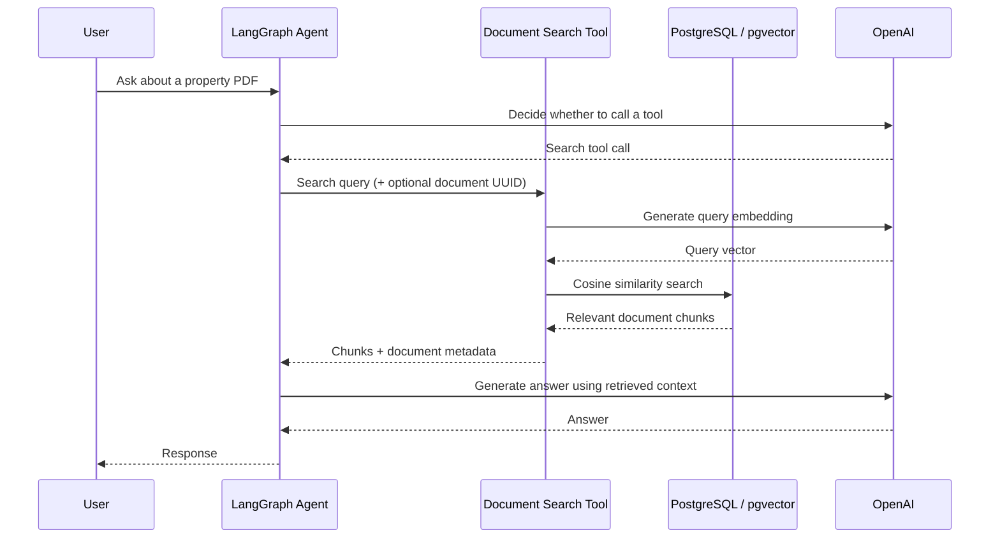

# AI Real Estate Operations Platform

A backend-focused AI real estate operations platform built with **FastAPI, PostgreSQL, LangGraph, OpenAI, AWS S3, and Arize Phoenix**. The project combines traditional real estate workflows with an AI agent that can use application tools and answer questions about uploaded property documents using retrieval-augmented generation (RAG).

> **Project status:** Core learning-project functionality is implemented and manually tested. This is a local development prototype, not a production-secured deployment.

## Features

### Real estate operations
- REST APIs for managing properties, clients, client preferences, and property viewings.
- SQLAlchemy-based persistence with PostgreSQL and Alembic migrations.
- Application-level handling of common not-found and conflict errors.

### AI agent
- A **LangGraph** agent that selects and invokes application tools.
- Read-only operations and a human-approval flow for sensitive actions such as scheduling viewings.
- Conversation state persisted through a **PostgreSQL LangGraph checkpointer**.

### Document management and RAG
- Upload PDF property documents through FastAPI.
- Extract text with **pypdf** and split it into overlapping chunks.
- Generate **1,536-dimensional** embeddings with OpenAI `text-embedding-3-small`.
- Store document metadata and embedded chunks in **PostgreSQL + pgvector**.
- Store original PDF files in a private **AWS S3** bucket.
- Search documents semantically, optionally filtering by document UUID.
- List documents, retrieve metadata, generate time-limited S3 download links, and delete documents.
- Basic PDF type, size, signature, and extraction validation.

### Observability
- **Arize Phoenix** tracing through OpenTelemetry/OpenInference.
- Inspect LangGraph execution, tool calls, retrieved document chunks, OpenAI calls, latency, and token usage.

## Tech stack

| Area | Technology |
| --- | --- |
| API | Python, FastAPI, Pydantic |
| Database | PostgreSQL, SQLAlchemy (async), Alembic |
| Vector search | pgvector |
| AI agent | LangGraph, LangChain |
| LLM and embeddings | OpenAI API |
| PDF processing | pypdf, LangChain text splitters |
| Object storage | AWS S3, boto3 |
| Conversation persistence | LangGraph PostgreSQL checkpointer |
| Observability | Arize Phoenix, OpenTelemetry, OpenInference |

## Architecture



The code separates **API routes**, **business logic in services**, and **database access in repositories**. The agent accesses business operations through tools rather than directly implementing database logic.

## PDF ingestion workflow

1. A client uploads a PDF to `POST /documents/upload`.
2. The API validates the upload and passes its contents to the document service.
3. The PDF service extracts text; the chunking service splits it into smaller passages.
4. The embedding service generates an embedding for each chunk.
5. The original PDF is uploaded to S3.
6. The repository saves the document metadata, chunk text, and vectors to PostgreSQL.
7. The database transaction is committed.

If database persistence fails after the S3 upload, the service attempts to roll back the database transaction and remove the uploaded object. This is **best-effort cleanup**, not an atomic transaction across PostgreSQL and S3.

## RAG question-answering workflow



The document search tool can filter by **document UUID**. When no UUID is supplied, retrieval searches across uploaded documents; similarly worded documents can therefore appear together in the results.

## Document API

These endpoints were implemented and manually exercised during development:

| Method | Endpoint | Description |
| --- | --- | --- |
| `POST` | `/documents/upload` | Upload, parse, embed, and persist a PDF |
| `POST` | `/documents/search` | Semantic search over document chunks |
| `GET` | `/documents/` | List uploaded documents |
| `GET` | `/documents/{document_id}` | Get document metadata |
| `GET` | `/documents/{document_id}/download` | Generate a time-limited S3 download URL |
| `DELETE` | `/documents/{document_id}` | Delete a document, its chunks, and its S3 object |
| `GET` | `/health` | Health response |

Other API routers provide property, client, viewing, client-preference, and agent operations. Use the generated **Swagger UI** for their current request schemas and route paths.

### Example: search uploaded PDFs

```http
POST /documents/search
Content-Type: application/json
```

```json
{
  "query": "What is the monthly rent and security deposit?",
  "limit": 5,
  "document_id": null
}
```

Set `document_id` to an uploaded document's UUID to restrict the search to that document.

## Running locally

### Prerequisites

- Python and a virtual environment
- PostgreSQL with the **pgvector** extension available
- AWS account with an S3 bucket and credentials permitted to access it
- OpenAI API key
- A configured PostgreSQL connection for LangGraph checkpoints

### 1. Install dependencies

From the backend directory, create and activate a virtual environment, then install the project's dependencies using its dependency file (for example, `requirements.txt` if present):

```bash
python -m venv .venv
# Windows PowerShell:
.venv\Scripts\Activate.ps1

pip install -r requirements.txt
```

> If your repository uses a different dependency manager or does not yet include `requirements.txt`, export your installed dependencies and update this section before sharing the project.

### 2. Configure environment variables

Create the local environment configuration expected by `app/core/config.py`. The application requires values corresponding to:

- PostgreSQL application database connection
- PostgreSQL LangGraph checkpoint connection
- OpenAI API key
- AWS access key ID and secret access key
- AWS region and S3 bucket name

**Use the exact variable names defined by your Settings class** in `app/core/config.py`; they are not reproduced here because the configuration source was not included in this README draft. Never commit your real `.env` or credentials.

### 3. Apply database migrations

```bash
alembic upgrade head
```

### 4. Start Phoenix (optional)

In a separate terminal:

```bash
phoenix serve
```

Open `http://localhost:6006`. The local application is configured to export traces to `http://localhost:6006/v1/traces` under the project name `ai-real-estate`.

### 5. Start FastAPI

From the backend directory:

```bash
python -m uvicorn app.main:app --reload
```

- API documentation: `http://127.0.0.1:8000/docs`
- Health endpoint: `http://127.0.0.1:8000/health`
- Phoenix dashboard: `http://localhost:6006`

## Example verified AI interaction

**Question:**

> What is the monthly rent and security deposit for the apartment in `test_property_listing.pdf`?

**Observed response:**

> The monthly rent is EUR 980. The security deposit is EUR 1,960.

Phoenix confirmed that the agent invoked `search_property_documents`, retrieved relevant PDF chunks, and generated its answer with `gpt-4.1-mini`.

All example property listings and contact details used in these tests are **fictional**.

## Project structure (selected modules)

```text
backend/
├── app/
│   ├── agents/                  # LangGraph agent and tools
│   ├── api/
│   │   └── routes/             # Properties, clients, viewings, documents, agent
│   ├── core/
│   │   ├── config.py
│   │   └── observability.py
│   ├── db/                      # Database setup and dependencies
│   ├── models/                  # SQLAlchemy models
│   ├── repositories/            # Database queries and persistence
│   ├── services/
│   │   ├── document_service.py
│   │   ├── pdf_service.py
│   │   ├── chunking_service.py
│   │   ├── embedding_service.py
│   │   └── s3_service.py
│   └── main.py
└── alembic/                     # Database migrations (location may vary)
```

## Limitations and future improvements

- **Authentication and authorization:** Protect API operations and enforce document-level access controls before public deployment. Presigned S3 URLs grant temporary access to whoever possesses them.
- **Retrieval precision:** Resolve filenames or require an explicit document selection to avoid mixing similarly worded PDFs.
- **Reliability:** Improve consistency and retry handling across S3 and database operations; current cleanup is best-effort.
- **Async performance:** boto3 calls in async request paths are synchronous.
- **Testing:** Add automated unit and integration tests; current workflows were manually tested through Swagger and Phoenix.
- **Deployment:** Add production configuration, secrets management, and deployment documentation if the project is hosted publicly.

## Learning outcomes

This project demonstrates integration of **traditional backend engineering**, **AI agent orchestration**, **semantic retrieval**, **cloud object storage**, and **LLM observability** in a single Python application.

---

*Portfolio learning project — AI Real Estate Operations Platform.*
